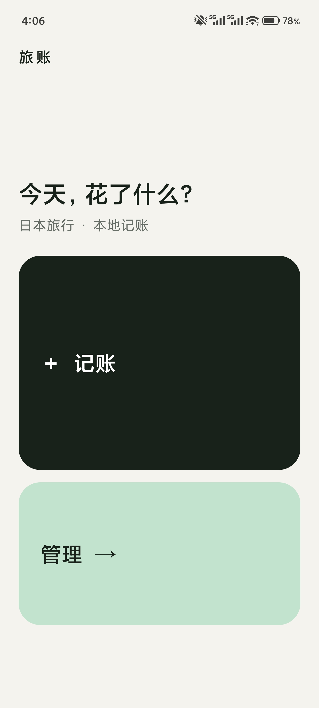
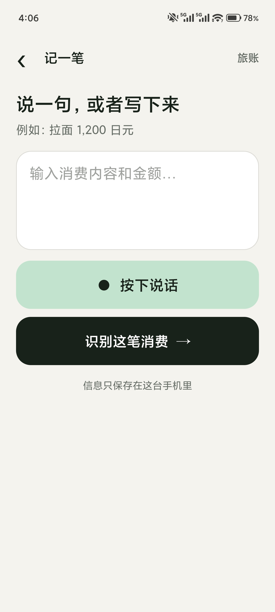
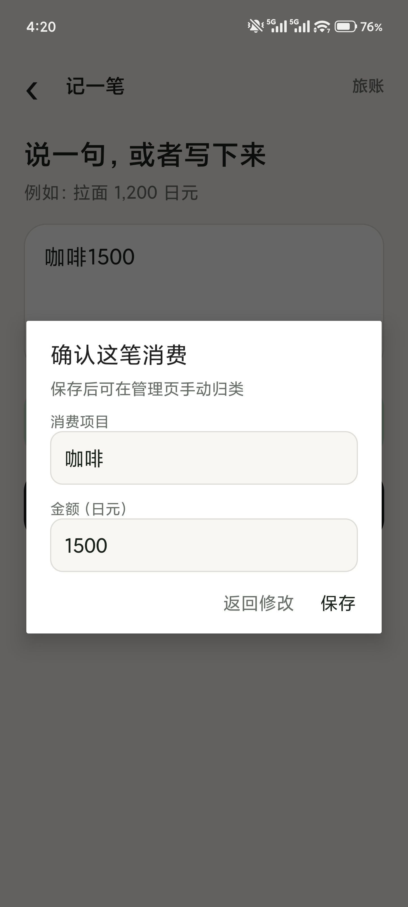
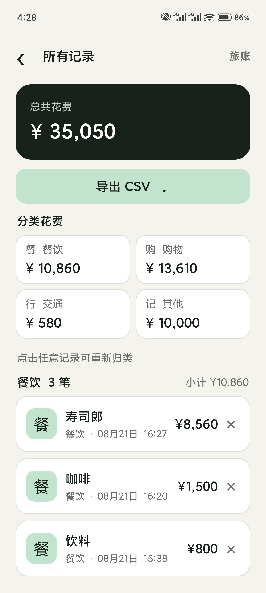

<div align="center">
  

  # 旅账 · Japan Travel Ledger

  **为日本旅行而生的极简、本地优先 Android 记账 App**  
  **A minimal, privacy-first Android expense tracker for travel in Japan.**

  [](https://github.com/Jason-Wu-7744/japan-travel-ledger/releases)
  [](app/src/main/java/com/japanledger/app/MainActivity.java)
  [](PRIVACY.md)
  [](PRIVACY.md)
  [](LICENSE)

  [下载 APK](https://github.com/Jason-Wu-7744/japan-travel-ledger/releases/latest) · [功能介绍](#核心功能) · [隐私说明](PRIVACY.md) · [English](#english)
</div>

---

## 旅账是什么？

旅账（Japan Travel Ledger）是一款开源的日本旅行记账、日元消费记录和旅行预算管理工具。它适合希望快速记录拉面、便利店、交通、购物等旅行开销，同时不想注册账号或把账目上传云端的 Android 用户。

输入或说出 `拉面 1200 日元`，旅账会在本地提取消费项目与金额，确认后保存。你可以在管理页手动归类、查看各类花费，并导出 CSV 进行报销、旅行复盘或预算分析。

> 核心记账、金额提取、分类、统计和 CSV 导出均在本机完成。语音转文字由手机的系统语音引擎提供，是否联网取决于设备厂商。

## 为什么选择旅账？

| 需求 | 旅账的做法 |
| --- | --- |
| 日本旅游快速记账 | 针对日元金额与中文自然语言输入优化 |
| 不想注册账号 | 无账号、无登录、无云端服务 |
| 保护消费隐私 | 账目保存在 Android 应用私有存储中 |
| 避免错误自动分类 | 新账目默认未分类，由用户手动决定 |
| 查看旅行预算结构 | 展示总额、分类金额、笔数和小计 |
| 带走或分析数据 | 导出 UTF-8 CSV，兼容 Excel 和 Numbers |
| 小米手机使用 | 已适配小米 14 Pro、HyperOS 3 和居中挖孔屏 |

## 核心功能

- **极简入口**：首页只保留「记账」和「管理」两个大按钮
- **自然语言记账**：从 `寿司 2800 日元`、`地铁 220 円` 等文本中提取项目和金额
- **语音输入**：调用 Android `SpeechRecognizer` 实现系统语音转文字
- **保存前确认**：识别结果可编辑，确认后才写入账本
- **手动分类**：餐饮、购物、交通、其他，避免关键词误判
- **分类统计**：总花费、分类花费、消费笔数与分类小计
- **CSV 导出**：通过 Android 系统文件选择器保存，无需通用存储权限
- **本地优先**：无账号、无广告、无统计 SDK、无账目服务器
- **设备适配**：Android 8.0+，兼容状态栏、底部导航栏和居中挖孔安全区域

## 界面预览

<table>
  <tr>
    <td align="center" width="50%">
      <br />
      <strong>极简首页 · 记账 / 管理</strong>
    </td>
    <td align="center" width="50%">
      <br />
      <strong>文字与语音记账</strong>
    </td>
  </tr>
  <tr>
    <td align="center" width="50%">
      <br />
      <strong>本地解析 · 保存前确认</strong>
    </td>
    <td align="center" width="50%">
      <br />
      <strong>分类统计 · CSV 导出</strong>
    </td>
  </tr>
</table>

## 三步开始使用

1. 从 [GitHub Releases](https://github.com/Jason-Wu-7744/japan-travel-ledger/releases/latest) 下载最新 APK 并安装。
2. 点击「记账」，输入或说出消费内容，例如 `便利店饮料 180 日元`。
3. 保存后进入「管理」，点击记录手动归类并查看分类统计。

### 导出账目

在管理页点击「导出 CSV」，选择保存位置。导出字段包括：

```text
日期时间,消费项目,类别,金额（日元）
```

CSV 使用 UTF-8 编码，可用 Excel、Numbers、Google Sheets、Python 或其他数据分析工具读取。

## 隐私与联网说明

| 功能 | 是否需要联网 | 数据位置 |
| --- | --- | --- |
| 文字记账与金额提取 | 否 | 本机 |
| 账目保存与分类统计 | 否 | 本机 |
| CSV 导出 | 否 | 用户选择的本地文件位置 |
| 语音转文字 | 取决于系统语音引擎 | 由手机语音服务决定 |

应用只申请麦克风权限，并且仅在用户主动点击语音按钮时调用。详见 [隐私说明](PRIVACY.md)。

## 技术架构

- 原生 Android Java，JDK 17，compile SDK 35
- 零第三方运行时依赖
- `SharedPreferences + JSON` 本地持久化
- 正则规则本地提取消费项目和金额
- Android `SpeechRecognizer` 系统语音接口
- Storage Access Framework 安全导出 CSV
- Android Window Insets / Display Cutout 安全区域适配

进一步了解实现：[架构说明](docs/ARCHITECTURE.md) · [主程序源码](app/src/main/java/com/japanledger/app/MainActivity.java)

## 本地构建

准备 JDK 17 和 Android SDK 35，然后克隆项目：

```bash
git clone https://github.com/Jason-Wu-7744/japan-travel-ledger.git
cd japan-travel-ledger
```

创建不提交到 Git 的 `local.properties`：

```properties
sdk.dir=/your/path/to/Android/sdk
```

构建调试 APK：

```bash
./gradlew assembleDebug
```

输出位置：

```text
app/build/outputs/apk/debug/app-debug.apk
```

## FAQ

<details>
<summary><strong>旅账需要联网吗？</strong></summary>

文字记账、解析、保存、统计与 CSV 导出均不需要联网。语音识别是否联网取决于手机安装的系统语音引擎。
</details>

<details>
<summary><strong>为什么不再自动分类？</strong></summary>

同一个项目在不同场景下可能属于不同类别。例如便利店购买饮料更像购物，而餐厅购买饮料可能属于餐饮。手动分类可以避免不可解释的误判。
</details>

<details>
<summary><strong>卸载后账目还在吗？</strong></summary>

不在。账目保存在应用私有存储中，卸载或清除应用数据会删除记录。建议旅行期间定期导出 CSV 备份。
</details>

<details>
<summary><strong>支持人民币或多币种吗？</strong></summary>

当前版本聚焦日本旅行，以日元为记账和统计单位。多币种与汇率换算尚未实现。
</details>

## 路线图

- [ ] 自定义消费类别
- [ ] 旅行日期与每日预算
- [ ] 多币种和可选汇率换算
- [ ] 本地备份与恢复
- [ ] 更完善的金额表达解析
- [ ] 可选的完全离线语音识别方案

欢迎通过 [Issues](https://github.com/Jason-Wu-7744/japan-travel-ledger/issues) 提交建议，或阅读 [贡献指南](CONTRIBUTING.md) 后参与开发。

## 版本与发布

- 当前版本：**2.1.0**
- [下载所有 APK 版本](https://github.com/Jason-Wu-7744/japan-travel-ledger/releases)
- [完整更新记录](CHANGELOG.md)
- [各版本发布说明](docs/releases)

如果旅账对你的旅行有帮助，欢迎点一个 ⭐ Star，让更多寻找离线旅行记账工具的人看到它。

---

## English

**Japan Travel Ledger** is an open-source, local-first Android expense tracker built for travel in Japan. It extracts an item and a Japanese-yen amount from natural language, stores every expense locally, supports manual categories, shows category totals, and exports UTF-8 CSV files.

### Highlights

- Fast JPY expense entry from text such as `ramen 1200 yen`
- Optional voice input through Android's system speech recognizer
- No account, cloud backend, ads, analytics SDK, or expense upload
- Manual categories: Food, Shopping, Transport, and Other
- Total spending, category totals, counts, and grouped records
- CSV export for Excel, Numbers, Google Sheets, Python, or reimbursement workflows
- Android 8.0+ and center punch-hole display support
- Tested and adjusted for Xiaomi 14 Pro / HyperOS 3

The core ledger works offline. System speech recognition may require network access depending on the selected speech engine.

**Search concepts:** offline Android expense tracker, Japan travel budget app, Japanese yen spending tracker, privacy-first travel ledger, local expense manager, voice expense entry, CSV expense export, HyperOS accounting app, 日本旅行记账, 日元记账, 离线记账, 旅行预算, 安卓开源记账, 日本旅行家計簿, 円支出管理.

See [Privacy](PRIVACY.md), [Architecture](docs/ARCHITECTURE.md), [Contributing](CONTRIBUTING.md), and [Releases](https://github.com/Jason-Wu-7744/japan-travel-ledger/releases).

## License

Released under the [MIT License](LICENSE).
