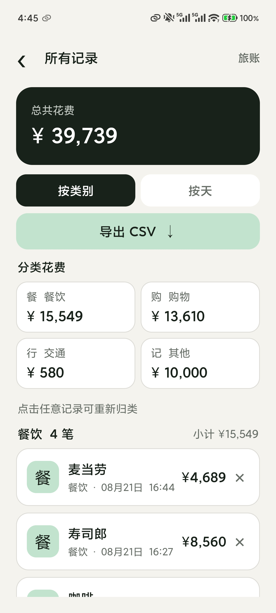
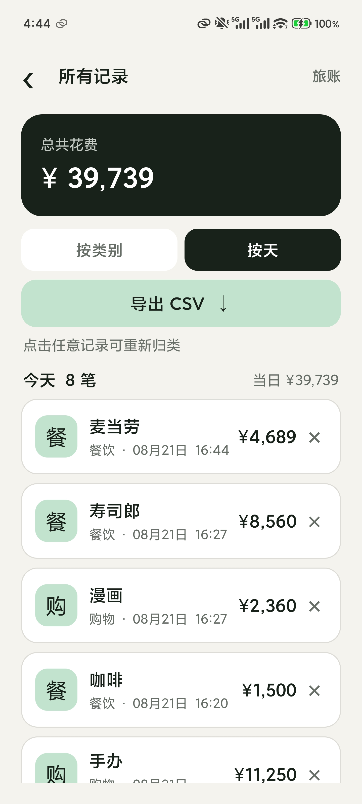

[English](README.md) | [中文](README.zh-CN.md)

  

  # Japan Travel Ledger · 旅账

  **A minimal, privacy-first Android expense tracker for travel in Japan.**

  
  
  
  
  

  [Download APK](https://github.com/Jason-Wu-7744/japan-travel-ledger/releases/latest) · [Features](#features) · [Privacy](PRIVACY.md) · [中文](README.zh-CN.md)

---

## What is Japan Travel Ledger?

Japan Travel Ledger (旅账) is an open-source Android app for recording Japanese-yen expenses and managing spending during a trip to Japan. It is designed for quick entries such as meals, convenience-store purchases, transport and shopping, without creating an account or uploading your ledger to a cloud service.

Type or say `拉面 1200 日元` (“ramen, 1,200 yen”). The app extracts the item and amount locally and saves the entry after you confirm it. In Manage (管理), you can customize categories, classify entries manually, refresh the JPY → CNY exchange rate, view converted spending and export CSV files for reimbursement, a trip review or budget analysis.

> Core bookkeeping, amount extraction, categories, statistics and CSV export run on your device. Speech-to-text uses the phone's system speech engine; whether it connects to the internet depends on the device and speech service.

## Why use it?

| Need | How the app handles it |
| --- | --- |
| Quick expense entry in Japan | Optimized for yen amounts and Chinese natural-language input |
| No account registration | No account, login or cloud service |
| Private spending records | Entries stay in Android app-private storage |
| Avoid incorrect automatic categories | New entries remain uncategorized until you classify them |
| More flexible categories | Add, rename or delete categories in Manage |
| Understand spending | View totals, category amounts, entry counts and subtotals |
| Estimate costs in Chinese yuan | Refresh the JPY → CNY rate or enter it manually |
| Take your data with you | Export UTF-8 CSV for Excel, Numbers and other tools |
| Xiaomi device support | Adjusted for Xiaomi 14 Pro, HyperOS 3 and centered camera cutouts |

## Features

- **Simple home screen:** two large buttons, Record (记账) and Manage (管理).
- **Natural-language entry:** extract an item and amount from text such as `寿司 2800 日元` or `地铁 220 円`.
- **Voice input:** use Android `SpeechRecognizer` for system speech-to-text.
- **Confirm before saving:** edit the recognized result before writing it to the ledger.
- **Custom categories:** start with Food and drink (餐饮), Shopping (购物), Transport (交通) and Other (其他), then add, rename or delete categories.
- **Manual classification:** new entries are uncategorized; tap an entry to choose any current category.
- **Category statistics:** view total spending, category spending, entry counts and subtotals.
- **Daily management:** browse each day's entries, counts and spending total.
- **Exchange-rate refresh:** fetch the JPY → CNY rate in Manage, with manual entry available offline.
- **CNY conversion:** show estimated Chinese-yuan values in totals, category subtotals, daily subtotals and CSV exports.
- **CSV export:** save through Android's system file picker without broad storage permission.
- **Local-first design:** no account, ads, analytics SDK or ledger server.
- **Device support:** Android 8.0+, with status-bar, navigation-bar and centered display-cutout safe areas.

## Screenshots

<table>
  <tr>
    <td align="center" width="50%">
       
      <strong>Home · Record / Manage</strong>
    </td>
    <td align="center" width="50%">
       
      <strong>Text and voice entry</strong>
    </td>
  </tr>
  <tr>
    <td align="center" width="50%">
       
      <strong>Local parsing · Confirm before saving</strong>
    </td>
    <td align="center" width="50%">
       
      <strong>Categories · Spending statistics</strong>
    </td>
  </tr>
  <tr>
    <td align="center" colspan="2">
       
      <strong>Daily view · Daily totals</strong>
    </td>
  </tr>
</table>

## Get started in three steps

1. Download and install the latest APK from [GitHub Releases](https://github.com/Jason-Wu-7744/japan-travel-ledger/releases/latest).
2. Tap Record (记账), then type or say an expense such as `便利店饮料 180 日元` (“convenience-store drink, 180 yen”).
3. After saving, open Manage (管理), tap an entry to classify it and review category statistics.

### Export your ledger

In Manage, tap Export CSV (导出 CSV) and choose a save location. The export contains these fields:

~~~text
日期时间,消费项目,类别,金额（日元）,汇率（日元到人民币）,折合人民币
~~~

The fields are date/time, item, category, amount in JPY, JPY-to-CNY exchange rate and equivalent CNY amount. CSV files use UTF-8 and can be read with Excel, Numbers, Google Sheets, Python or other analysis tools.

## Privacy and network access

| Feature | Internet needed? | Where data is handled |
| --- | --- | --- |
| Text entry and amount extraction | No | On your device |
| Ledger storage and category statistics | No | On your device |
| Exchange-rate refresh | Yes | Requests a public rate API; no ledger entries are uploaded |
| CSV export | No | The local file location you choose |
| Speech-to-text | Depends on the system speech engine | Determined by the phone's speech service |

The app requests microphone and internet permissions. The microphone is used only when you tap the voice-input button. The app's exchange-rate request runs when you refresh the rate; the system speech service may also use the network. See [Privacy](PRIVACY.md).

## Architecture

- Native Android Java, JDK 17 and compile SDK 35.
- No third-party runtime dependencies.
- Local persistence with `SharedPreferences + JSON`.
- Regular-expression rules to extract expense items and amounts locally.
- `HttpURLConnection` to fetch a public JPY → CNY rate and cache it locally.
- Android `SpeechRecognizer` for system speech input.
- Storage Access Framework for CSV export.
- Android Window Insets / Display Cutout handling for safe areas.

Read the [architecture notes](docs/ARCHITECTURE.md) or [main source file](app/src/main/java/com/japanledger/app/MainActivity.java).

## Build locally

Prepare JDK 17 and Android SDK 35, then clone the project:

~~~bash
git clone https://github.com/Jason-Wu-7744/japan-travel-ledger.git
cd japan-travel-ledger
~~~

Create a `local.properties` file and keep it out of Git:

~~~properties
sdk.dir=/your/path/to/Android/sdk
~~~

Build a debug APK:

~~~bash
./gradlew assembleDebug
~~~

Output:

~~~text
app/build/outputs/apk/debug/app-debug.apk
~~~

## FAQ

<strong>Does the app need an internet connection?</strong>

Text entry, parsing, saving, statistics and CSV export work offline. Refreshing the exchange rate uses the internet. Whether voice recognition connects depends on the system speech engine installed on your phone.

<strong>Why are expenses categorized manually?</strong>

The same item can belong to different categories in different situations. A drink from a convenience store might be shopping, while a drink at a restaurant might belong under food and drink. Manual classification avoids unexplained automatic guesses.

<strong>Will my records survive uninstalling the app?</strong>

No. Records are stored in app-private storage, so uninstalling the app or clearing its data deletes them. Export CSV backups regularly during your trip.

<strong>Does it support CNY or multiple currencies?</strong>

JPY is the ledger's main currency. You can refresh the JPY → CNY rate in Manage and see estimated Chinese-yuan amounts. Input explicitly marked as 人民币, RMB, CNY or 块 is converted into JPY at the current rate before it is saved.

## Roadmap

- [x] Custom expense categories
- [ ] Trip dates and daily budgets
- [x] JPY-to-CNY conversion
- [ ] Local backup and restore
- [ ] More complete amount-expression parsing
- [ ] Optional fully offline speech recognition

Suggestions are welcome in [Issues](https://github.com/Jason-Wu-7744/japan-travel-ledger/issues). Read [Contributing](CONTRIBUTING.md) to help with development.

## Version and releases

- Current version: **3.0.0**
- [All APK releases](https://github.com/Jason-Wu-7744/japan-travel-ledger/releases)
- [Full changelog](CHANGELOG.md)
- [Release notes by version](docs/releases)

If the app helps with your trip, a GitHub star can help other travelers find it.

## License

Released under the [MIT License](LICENSE).

